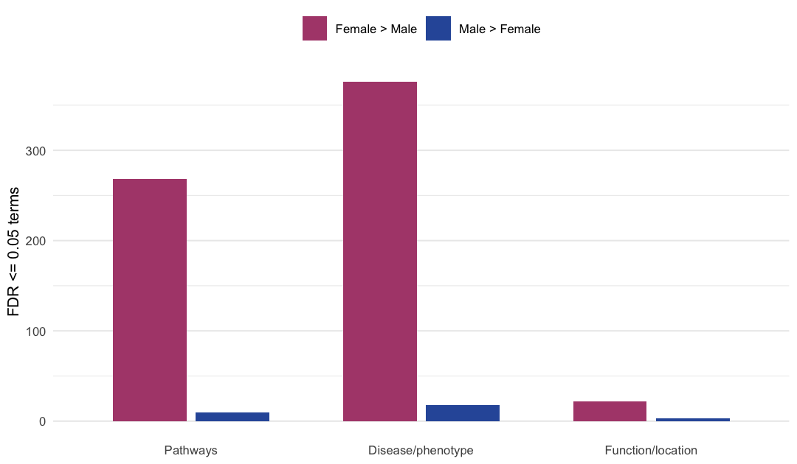
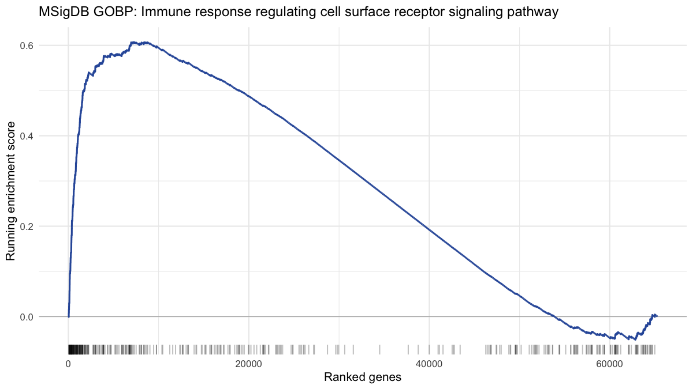
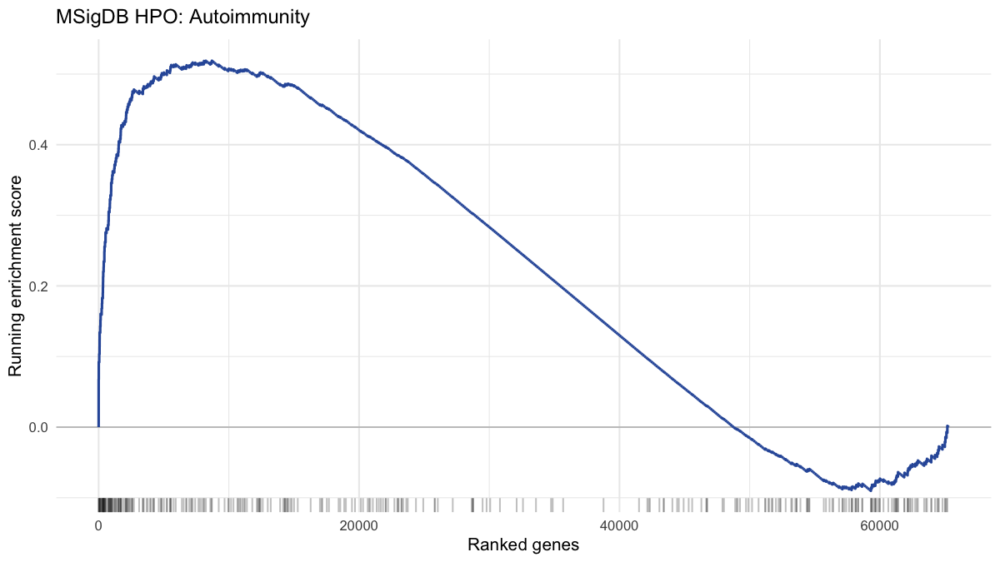

# GTEx Thyroid Sex Contrast

GTEx v11 thyroid samples were contrasted by sex using DESeq2 on raw counts, adjusting for age group, Hardy death class, RNA integrity, tissue ischemic time, and sequencing center. Genes were ranked by the Wald statistic for Female vs Male and tested against three ALIEN GTEx/Gencode GMT collections with multilevel rsfgsea: pathways, disease/phenotype, and function/location. The cancer-programme and cell-line collections are not used for normal tissue.

- Samples: 683 total (224 Female, 459 Male).
- Ranked genes: 65295.
- DESeq2 design: `~ AGE + DTHHRDY + SMRIN + SMTSISCH + SMCENTER + sex`.
- GMT files under `results/alien_outputs`: `pathways/gmt/gtex_v11_gencode47.gmt`, `disease_phenotype/gmt/gtex_v11_gencode47.gmt`, `function_location/gmt/gtex_v11_gencode47.gmt`.
- rsfgsea: `rsfgsea` in multilevel mode.
- Direction: positive NES means Female > Male; negative NES means Male > Female.

## Main Result

FDR-significant enrichment was present in 3 of 3 collections. The broadest signal was in `Disease/phenotype` (376 Female > Male terms, 18 Male > Female terms), with the larger directional count in Female > Male sets.

## Data Products

- DESeq2 table: [gtex_thyroid_female_vs_male_deseq2.tsv](../../../../results/sex_contrast/gtex_thyroid/tables/gtex_thyroid_female_vs_male_deseq2.tsv)
- Rank file: [gtex_thyroid_female_vs_male.ranks.tsv](../../../../results/sex_contrast/gtex_thyroid/ranks/gtex_thyroid_female_vs_male.ranks.tsv)

## Collection Summary

The figure below gives a collection-level view of significant enrichment. Detailed term-level results are shown in the tables; figures are limited to the clearest thyroid immune and autoimmune examples.

Collection | Tested terms | FDR <= 0.05 | Strongest Female > Male | Strongest Male > Female
--- | --- | --- | --- | ---
Pathways | 7626 | 278 | GOBP: Immune response regulating cell surface receptor signaling pathway (NES 2.21, FDR 1.75e-16) | GOBP: Cilium organization (NES -1.95, FDR 0.00193)
Disease/phenotype | 11804 | 394 | HPO: Abnormal lymphocyte morphology (NES 2.16, FDR 7.37e-10) | Jensen Diseases Experimental 2025: Autistic disorder (NES -2.35, FDR 3.62e-06)
Function/location | 1825 | 25 | GOCC: T cell receptor complex (NES 2.49, FDR 2.23e-15) | GOCC: Axoneme (NES -2.24, FDR 0.00876)

## Enrichment Results

### Pathways

- GMT: `results/alien_outputs/pathways/gmt/gtex_v11_gencode47.gmt`.
- rsfgsea table: [gtex_thyroid_pathways_female_vs_male_rsfgsea.tsv](../../../../results/sex_contrast/gtex_thyroid/tables/gtex_thyroid_pathways_female_vs_male_rsfgsea.tsv)
- Tested 7626 terms; 278 had FDR <= 0.05.
- Strongest Female > Male signal: GOBP: Immune response regulating cell surface receptor signaling pathway (NES 2.21, FDR 1.75e-16).
- Strongest Male > Female signal: GOBP: Cilium organization (NES -1.95, FDR 0.00193).

Top enrichment rows:

Source | Collection | Term | NES | P value | FDR | Genes
--- | --- | --- | --- | --- | --- | ---
MSigDB | GOBP | Immune response regulating cell surface receptor signaling pathway | 2.211 | 2.298e-20 | 1.752e-16 | 402
MSigDB | GOBP | Antigen receptor mediated signaling pathway | 2.323 | 5.518e-16 | 2.104e-12 | 220
MSigDB | GOBP | Leukocyte cell cell adhesion | 2.006 | 3.161e-15 | 8.035e-12 | 436
MSigDB | GOBP | Lymphocyte differentiation | 1.966 | 1.475e-14 | 2.812e-11 | 454
MSigDB | GOBP | T cell receptor signaling pathway | 2.328 | 4.966e-14 | 7.573e-11 | 161
MSigDB | GOBP | Regulation of T cell activation | 1.991 | 1.879e-13 | 2.388e-10 | 402
MSigDB | GOBP | Leukocyte mediated cytotoxicity | 2.305 | 5.418e-13 | 5.902e-10 | 156
MSigDB | Hallmark | Allograft rejection | 2.221 | 2.136e-12 | 2.036e-09 | 200

Selected figure:

### Disease/phenotype

- GMT: `results/alien_outputs/disease_phenotype/gmt/gtex_v11_gencode47.gmt`.
- rsfgsea table: [gtex_thyroid_disease_phenotype_female_vs_male_rsfgsea.tsv](../../../../results/sex_contrast/gtex_thyroid/tables/gtex_thyroid_disease_phenotype_female_vs_male_rsfgsea.tsv)
- Tested 11804 terms; 394 had FDR <= 0.05.
- Strongest Female > Male signal: HPO: Abnormal lymphocyte morphology (NES 2.16, FDR 7.37e-10).
- Strongest Male > Female signal: Jensen Diseases Experimental 2025: Autistic disorder (NES -2.35, FDR 3.62e-06).

Top enrichment rows:

Source | Collection | Term | NES | P value | FDR | Genes
--- | --- | --- | --- | --- | --- | ---
MSigDB | HPO | Abnormal lymphocyte morphology | 2.161 | 6.244e-14 | 7.37e-10 | 263
MSigDB | HPO | Abnormal T cell morphology | 2.28 | 3.932e-13 | 2.32e-09 | 133
MSigDB | HPO | Abnormal leukocyte physiology | 1.951 | 6.353e-12 | 2.5e-08 | 353
MSigDB | HPO | Abnormal B cell morphology | 2.248 | 8.934e-12 | 2.636e-08 | 112
MSigDB | HPO | Abnormality of humoral immunity | 1.92 | 1.147e-11 | 2.707e-08 | 359
MSigDB | HPO | Abnormal lymphocyte count | 2.03 | 1.897e-10 | 3.731e-07 | 209
MSigDB | HPO | Abnormal lymph node morphology | 1.976 | 2.779e-10 | 4.686e-07 | 269
Enrichr | Jensen Diseases Curated 2025 | Primary immunodeficiency disease | 2.044 | 4.288e-10 | 6.327e-07 | 215

Selected figure:

### Function/location

- GMT: `results/alien_outputs/function_location/gmt/gtex_v11_gencode47.gmt`.
- rsfgsea table: [gtex_thyroid_function_location_female_vs_male_rsfgsea.tsv](../../../../results/sex_contrast/gtex_thyroid/tables/gtex_thyroid_function_location_female_vs_male_rsfgsea.tsv)
- Tested 1825 terms; 25 had FDR <= 0.05.
- Strongest Female > Male signal: GOCC: T cell receptor complex (NES 2.49, FDR 2.23e-15).
- Strongest Male > Female signal: GOCC: Axoneme (NES -2.24, FDR 0.00876).

Top enrichment rows:

Source | Collection | Term | NES | P value | FDR | Genes
--- | --- | --- | --- | --- | --- | ---
MSigDB | GOCC | T cell receptor complex | 2.485 | 1.219e-18 | 2.225e-15 | 139
MSigDB | GOMF | Immune receptor activity | 2.293 | 6.526e-14 | 5.955e-11 | 167
MSigDB | GOCC | Plasma membrane signaling receptor complex | 2.073 | 2.306e-13 | 1.403e-10 | 353
MSigDB | GOCC | Immunoglobulin complex | 2.162 | 7.803e-11 | 3.56e-08 | 170
MSigDB | GOMF | Antigen binding | 2.058 | 6.475e-10 | 2.363e-07 | 168
MSigDB | GOCC | External side of plasma membrane | 1.836 | 8.878e-09 | 2.7e-06 | 378
MSigDB | GOMF | Pattern recognition receptor activity | 2.085 | 3.304e-07 | 8.614e-05 | 53
MSigDB | GOMF | Peptide antigen binding | 2.081 | 4.629e-07 | 0.0001056 | 45

