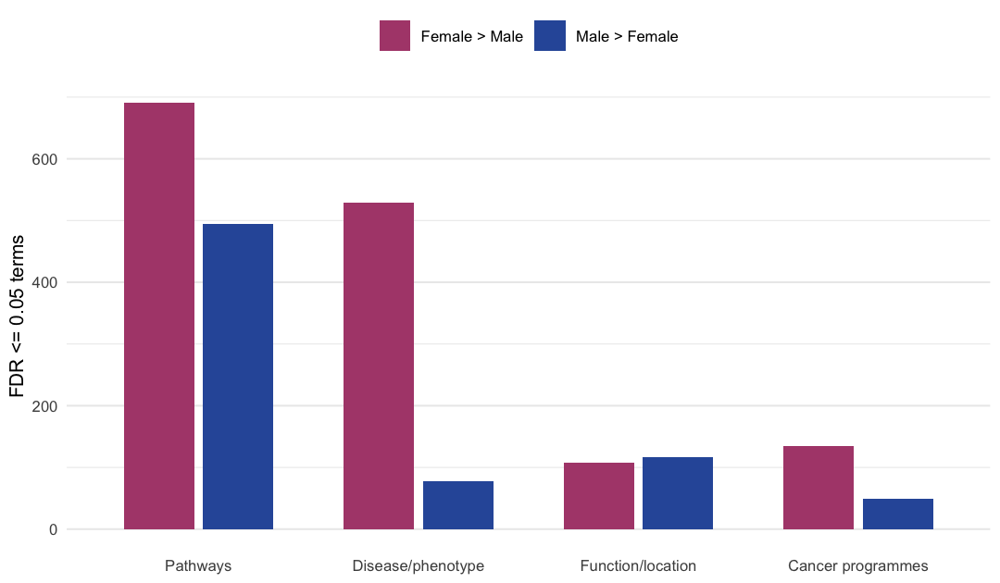
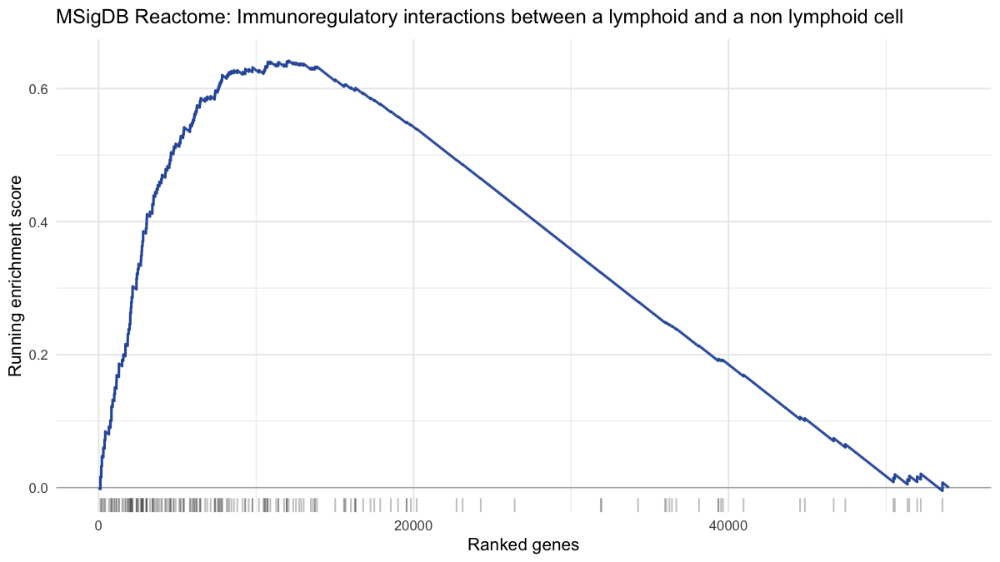
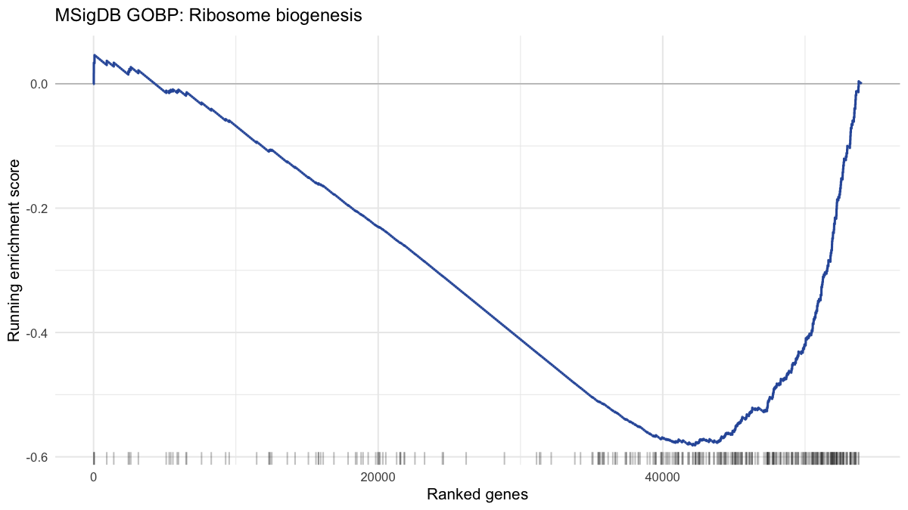
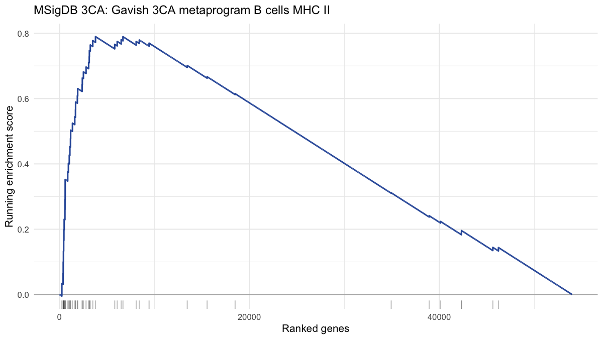
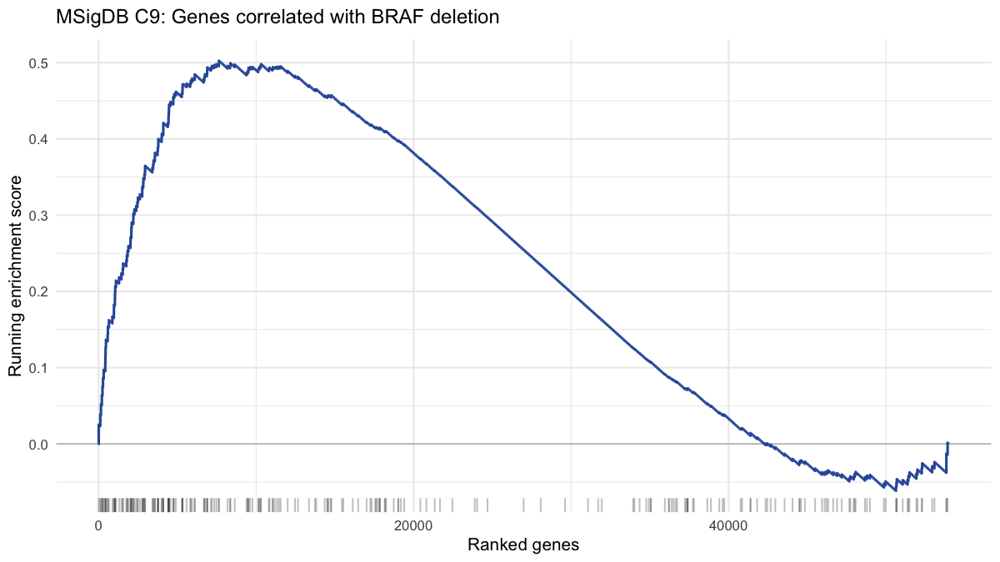

# TCGA Lung Cancer Sex Contrast

TCGA LUAD and LUSC primary tumors from recount3 were contrasted by sex using DESeq2 on raw counts, adjusting for cancer project and age at diagnosis. Genes were ranked by the Wald statistic for Female vs Male and tested against all four ALIEN TCGA GMT collections with multilevel rsfgsea.

- Projects: LUAD, LUSC.
- Sample type: Primary Tumor.
- Samples: 998 total (404 Female, 594 Male).
- Ranked genes: 53984.
- DESeq2 design: `~ project + age_at_diagnosis + sex`.
- GMT files under `results/alien_outputs`: `pathways/gmt/tcga_recount3_gencode29.gmt`, `disease_phenotype/gmt/tcga_recount3_gencode29.gmt`, `function_location/gmt/tcga_recount3_gencode29.gmt`, `cancer_programs/gmt/tcga_recount3_gencode29.gmt`.
- rsfgsea: `rsfgsea` in multilevel mode.
- Direction: positive NES means Female > Male; negative NES means Male > Female.

## Main Result

FDR-significant enrichment was present in 4 of 4 collections. The broadest signal was in `Pathways` (691 Female > Male terms, 495 Male > Female terms), with the larger directional count in Female > Male sets.

## Data Products

- DESeq2 table: [tcga_lung_female_vs_male_deseq2.tsv](../../../../results/sex_contrast/tcga_lung/tables/tcga_lung_female_vs_male_deseq2.tsv)
- Rank file: [tcga_lung_female_vs_male.ranks.tsv](../../../../results/sex_contrast/tcga_lung/ranks/tcga_lung_female_vs_male.ranks.tsv)

## Collection Summary

The figure below gives a collection-level view of significant enrichment. Detailed term-level results are shown in the tables; figures are limited to the clearest pathway and cancer-programme examples.

Collection | Tested terms | FDR <= 0.05 | Strongest Female > Male | Strongest Male > Female
--- | --- | --- | --- | ---
Pathways | 7678 | 1186 | Reactome: Immunoregulatory interactions between a lymphoid and a non lymphoid... (NES 2.41, FDR 9.33e-15) | Hallmark: E2F targets (NES -2.58, FDR 1.04e-10)
Disease/phenotype | 11820 | 606 | Jensen Diseases Curated 2025: Primary immunodeficiency disease (NES 2.19, FDR 4.02e-10) | DisGeNET: Spermatogenic failure nonobstructive y-linked (NES -2.4, FDR 9.52e-08)
Function/location | 1835 | 224 | GOCC: External side of plasma membrane (NES 2.34, FDR 1.98e-21) | GOMF: Catalytic activity acting on RNA (NES -2.14, FDR 5.77e-09)
Cancer programmes | 399 | 184 | C9: Genes correlated with RHOA deletion (NES 2.63, FDR 6.24e-30) | 3CA: Gavish 3CA malignant metaprogram 20 MYC (NES -2.42, FDR 4.42e-06)

## Enrichment Results

### Pathways

- GMT: `results/alien_outputs/pathways/gmt/tcga_recount3_gencode29.gmt`.
- rsfgsea table: [tcga_lung_pathways_female_vs_male_rsfgsea.tsv](../../../../results/sex_contrast/tcga_lung/tables/tcga_lung_pathways_female_vs_male_rsfgsea.tsv)
- Tested 7678 terms; 1186 had FDR <= 0.05.
- Strongest Female > Male signal: Reactome: Immunoregulatory interactions between a lymphoid and a non lymphoid... (NES 2.41, FDR 9.33e-15).
- Strongest Male > Female signal: Hallmark: E2F targets (NES -2.58, FDR 1.04e-10).

Top enrichment rows:

Source | Collection | Term | NES | P value | FDR | Genes
--- | --- | --- | --- | --- | --- | ---
MSigDB | Reactome | Immunoregulatory interactions between a lymphoid and a non lymphoid cell | 2.406 | 2.163e-18 | 9.334e-15 | 186
MSigDB | GOBP | Leukocyte proliferation | 2.194 | 2.431e-18 | 9.334e-15 | 347
MSigDB | GOBP | Leukocyte cell cell adhesion | 2.069 | 1.665e-17 | 4.262e-14 | 450
MSigDB | Hallmark | Interferon gamma response | 2.358 | 2.271e-17 | 4.358e-14 | 199
MSigDB | GOBP | Regulation of leukocyte proliferation | 2.219 | 4.929e-17 | 7.569e-14 | 275
MSigDB | GOBP | Immune response regulating cell surface receptor signaling pathway | 2.081 | 9.602e-17 | 1.229e-13 | 411
MSigDB | GOBP | Regulation of T cell activation | 2.046 | 2.593e-15 | 2.844e-12 | 408
MSigDB | GOBP | Positive regulation of cell activation | 2.051 | 3.092e-15 | 2.968e-12 | 392

Selected figures:

### Disease/phenotype

- GMT: `results/alien_outputs/disease_phenotype/gmt/tcga_recount3_gencode29.gmt`.
- rsfgsea table: [tcga_lung_disease_phenotype_female_vs_male_rsfgsea.tsv](../../../../results/sex_contrast/tcga_lung/tables/tcga_lung_disease_phenotype_female_vs_male_rsfgsea.tsv)
- Tested 11820 terms; 606 had FDR <= 0.05.
- Strongest Female > Male signal: Jensen Diseases Curated 2025: Primary immunodeficiency disease (NES 2.19, FDR 4.02e-10).
- Strongest Male > Female signal: DisGeNET: Spermatogenic failure nonobstructive y-linked (NES -2.4, FDR 9.52e-08).

Top enrichment rows:

Source | Collection | Term | NES | P value | FDR | Genes
--- | --- | --- | --- | --- | --- | ---
Enrichr | Jensen Diseases Curated 2025 | Primary immunodeficiency disease | 2.192 | 3.397e-14 | 4.015e-10 | 216
Enrichr | Jensen Diseases Curated 2025 | Autoimmune disease | 2.222 | 9.613e-13 | 5.681e-09 | 170
Enrichr | DisGeNET | Common variable immunodeficiency | 2.21 | 7.645e-12 | 2.259e-08 | 150
MSigDB | HPO | Abnormal paranasal sinus morphology | 2.112 | 7.073e-12 | 2.259e-08 | 199
MSigDB | HPO | Abnormal pulmonary thoracic imaging finding | 2.146 | 1.308e-11 | 3.093e-08 | 166
Enrichr | Jensen Diseases Curated 2025 | Autoimmune disease of musculoskeletal system | 2.173 | 2.774e-11 | 5.465e-08 | 140
Enrichr | DisGeNET | Spermatogenic failure nonobstructive y-linked | -2.404 | 7.943e-11 | 9.515e-08 | 16
MSigDB | HPO | Meningitis | 2.278 | 5.896e-11 | 9.515e-08 | 80

### Function/location

- GMT: `results/alien_outputs/function_location/gmt/tcga_recount3_gencode29.gmt`.
- rsfgsea table: [tcga_lung_function_location_female_vs_male_rsfgsea.tsv](../../../../results/sex_contrast/tcga_lung/tables/tcga_lung_function_location_female_vs_male_rsfgsea.tsv)
- Tested 1835 terms; 224 had FDR <= 0.05.
- Strongest Female > Male signal: GOCC: External side of plasma membrane (NES 2.34, FDR 1.98e-21).
- Strongest Male > Female signal: GOMF: Catalytic activity acting on RNA (NES -2.14, FDR 5.77e-09).

Top enrichment rows:

Source | Collection | Term | NES | P value | FDR | Genes
--- | --- | --- | --- | --- | --- | ---
MSigDB | GOCC | External side of plasma membrane | 2.335 | 1.081e-24 | 1.984e-21 | 380
MSigDB | GOCC | T cell receptor complex | 2.595 | 1.881e-21 | 1.726e-18 | 142
MSigDB | GOMF | Immune receptor activity | 2.45 | 3.483e-19 | 2.13e-16 | 169
MSigDB | GOMF | Antigen binding | 2.417 | 2.092e-18 | 9.596e-16 | 170
MSigDB | GOCC | Plasma membrane signaling receptor complex | 2.184 | 5.361e-18 | 1.968e-15 | 356
MSigDB | GOCC | Immunoglobulin complex | 2.379 | 1.28e-17 | 3.914e-15 | 173
MSigDB | GOCC | Axoneme | 2.096 | 1.651e-12 | 4.327e-10 | 235
MSigDB | GOMF | Catalytic activity acting on RNA | -2.14 | 2.515e-11 | 5.768e-09 | 428

### Cancer programmes

- GMT: `results/alien_outputs/cancer_programs/gmt/tcga_recount3_gencode29.gmt`.
- rsfgsea table: [tcga_lung_cancer_programs_female_vs_male_rsfgsea.tsv](../../../../results/sex_contrast/tcga_lung/tables/tcga_lung_cancer_programs_female_vs_male_rsfgsea.tsv)
- Tested 399 terms; 184 had FDR <= 0.05.
- Strongest Female > Male signal: C9: Genes correlated with RHOA deletion (NES 2.63, FDR 6.24e-30).
- Strongest Male > Female signal: 3CA: Gavish 3CA malignant metaprogram 20 MYC (NES -2.42, FDR 4.42e-06).

Top enrichment rows:

Source | Collection | Term | NES | P value | FDR | Genes
--- | --- | --- | --- | --- | --- | ---
MSigDB | C9 | Genes correlated with RHOA deletion | 2.634 | 1.565e-32 | 6.245e-30 | 280
MSigDB | C9 | Genes correlated with H3C2 deletion | 2.342 | 8.476e-20 | 1.691e-17 | 249
MSigDB | C9 | Genes correlated with H3C3 deletion | 2.447 | 1.968e-17 | 2.618e-15 | 159
MSigDB | C9 | Genes correlated with MYB deletion | 2.691 | 8.55e-17 | 7.289e-15 | 60
MSigDB | C6 | RPS14 dn.V1 up | 2.315 | 9.134e-17 | 7.289e-15 | 190
MSigDB | C9 | Genes correlated with PIK3CD deletion | 2.518 | 3.312e-12 | 2.202e-10 | 35
MSigDB | 3CA | Gavish 3CA metaprogram B cells MHC II | 2.475 | 1.466e-11 | 7.852e-10 | 50
MSigDB | C9 | Genes correlated with DNM2 deletion | 2.39 | 1.574e-11 | 7.852e-10 | 80

Selected figures:

